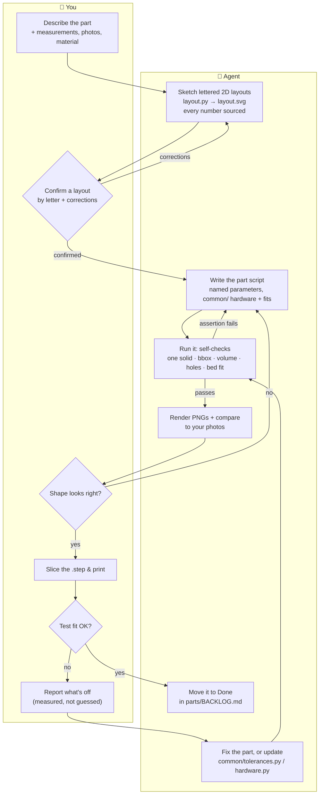

# 3dprint-starter

Code-first CAD for functional 3D-printed parts (brackets, clamps, mounts,
enclosures). Every part is a Python script in [build123d](https://build123d.readthedocs.io):
dimensions are named parameters, the part checks itself (one solid, right
size, holes where they should be, fits the bed), and it exports a `.step`
you drop into your slicer.

It's set up to work well with [Claude Code](https://claude.com/claude-code):
`CLAUDE.md` teaches it the workflow, so you can describe a part and it
sketches, builds, checks, and renders it.

## Setup (once, ~3 minutes)

macOS or Linux, with git installed:

```sh
./setup.sh
```

That installs everything into this folder: Python 3.12 + build123d (`./venv`),
a browser-based 3D viewer (`./.viewer-venv`), F3D for PNG renders (via
Homebrew), the VS Code OCP CAD Viewer extension (if VS Code is installed), and
a pre-commit check. It ends by building the example part. It's
safe to re-run any time. `./setup.sh --minimal` skips the viewers and F3D.

Then set your printer in **`common/printer.py`** (bed size, nozzle).

## Use

```sh
./venv/bin/python scripts/new.py part phone_holder   # scaffold a new part
./venv/bin/python parts/phone_holder/phone_holder.py # build it -> phone_holder.step
./venv/bin/python scripts/view.py phone_holder       # orbit it in a browser tab
./venv/bin/python scripts/render.py phone_holder     # iso/top/front/right PNGs in exports/
./venv/bin/python scripts/build_all.py               # re-check every part
```

Or open Claude Code in this folder and say what you want, e.g. *"a wall
bracket for a 32mm broom handle, two M5 screws, PETG"*.

## Workflow: you and the agent

Claude Code follows this loop (spelled out in `CLAUDE.md`). You supply
measurements and decisions; the agent writes the code, checks it, and shows
you pictures before you spend filament.



Doing it without an agent? The same loop works by hand: `scripts/new.py`,
edit, run, `scripts/render.py`, print.

VS Code users: setup installs the OCP CAD Viewer extension. The interpreter is preset to `./venv`, so each run of a part script
updates the viewer panel.

## Layout

| Path | What |
| --- | --- |
| `parts/<name>/` | one printable part: `<name>.py`, its exported `.step`, optional `layout.py` sketch |
| `assemblies/<name>/` | several parts plus reference geometry, with fit checks (overlaps, gaps, contact) |
| `common/` | shared helpers: `printer.py`, `hardware.py` (bolts, inserts, nuts), `tolerances.py` (fit clearances), `verify.py`, `sketch.py`, `assembly.py` |
| `scripts/` | `new.py`, `view.py`, `render.py`, `build_all.py` |
| `parts/BACKLOG.md` | ideas → done |
| `docs/viewer.md` | viewer and render details |

`parts/shovel_mount/` and `assemblies/shovel_on_rail/` are worked examples.
Read them, then delete them whenever you like.

## Tune it to your printer

The numbers in `common/tolerances.py` (fit clearances) and
`common/hardware.py` (heat-set insert holes) are starting points. Print a
test piece, measure, and update the table, not the part. Every part
picks up the change.
