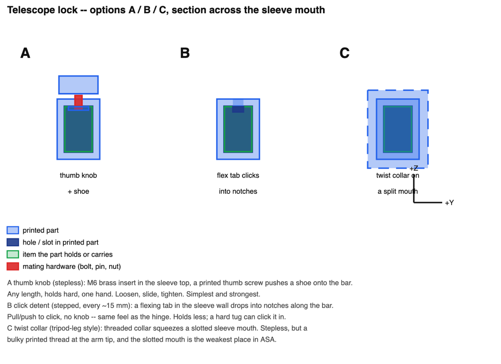
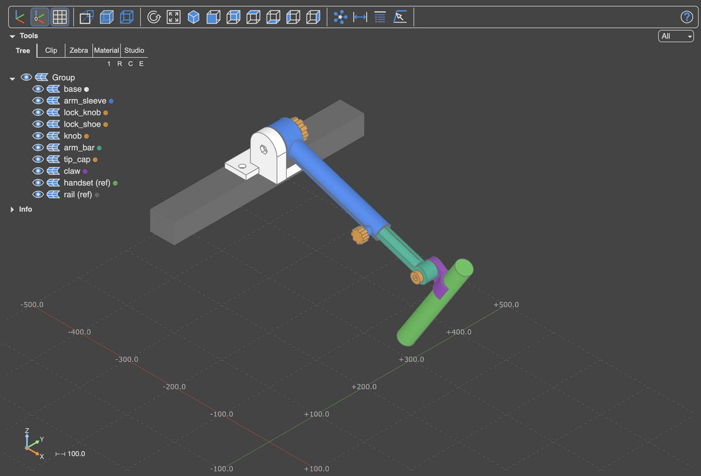

# 3dprint-starter

**Design your own 3D-printable parts by describing them to an AI.** You say
what you need ("a mount for my shower head on the roof rack, height
adjustable, folds away"), share a few photos and measurements, and Claude
designs it with you: it asks questions, draws options for you to pick from,
builds a 3D model you can spin around, checks that it will fit and print, and
hands you a file to send to your printer.

No CAD software and no coding needed. You make the decisions; Claude does the
drawing, the maths and the checking.

<p align="center">
  
  
</p>
<p align="center"><em>Left: Claude sketches options A, B and C for you to choose from.
Right: the finished design, a folding shower-head arm, in the 3D viewer.</em></p>

## What you need

- **A Mac** (Linux works too).
- **[Claude Code](https://claude.com/claude-code)** with a Claude account. We
  recommend running it inside the **Orca** app, which shows Claude, your
  sketches and the 3D model side by side. Plain Terminal and VS Code work too.
- **A 3D printer** and its slicer (Bambu Studio, OrcaSlicer, PrusaSlicer...).
- **Digital calipers** help a lot (about $20). Good measurements make parts that fit first time.

## Get started (about 10 minutes)

Open Terminal, paste this, and press Enter:

```sh
git clone https://github.com/CharlieKanG0/3dprint-starter.git ~/3dprint && cd ~/3dprint && ./setup.sh
```

Then open the `3dprint` folder in Claude Code and say hello. Claude will ask a
few questions about your printer and what you like to make, and set itself up.
**[Getting started](docs/getting-started.md)** walks through every step,
including installing Claude Code and printing your first part.

## How designing works

1. **You describe what you need.** Photos of where it goes, measurements if
   you have them, and anything that matters ("must fold flat", "PETG").
2. **Claude asks questions** about anything it can't see or look up. If you
   send a product link, it reads the specs itself.
3. **Claude sketches options**, labelled A, B, C, and recommends one. You
   reply with a letter, plus any changes ("B, but make the arm longer").
   Nothing gets modelled until you've picked.
4. **Claude builds the 3D model.** It opens in a viewer you can spin and
   zoom. Behind the scenes it checks the part is solid, fits your printer's
   bed, and that moving pieces don't collide.
5. **You print it,** starting with the small critical piece to test the fit.
6. **Tell Claude how it fit** ("the clip is about 1 mm loose"). It adjusts
   the design, and remembers the correction for your future parts.

More on each step, with tips: **[Designing a part](docs/designing.md)**.

## What you get

For each part, one or more **`.step` files**: the 3D shapes, already turned
the right way up for printing. Drag them into your slicer, pick your material,
and print. Claude's summary tells you which piece is which, what bolts or
inserts to buy, and what to print first.

## What's in this folder

| Folder or file | What it is | Do you touch it? |
| --- | --- | --- |
| `parts/` | Your designs, one folder each, with sketches and print files | This is where your work lives |
| `things/` | Measurements of the real things your parts attach to (a roof rack, a rail, a pipe), so Claude never asks twice | Claude fills it in, with your OK |
| `PROJECT.md` | About you: your printer, favourite materials, what you make | Claude fills it in on day one |
| `parts/BACKLOG.md` | Ideas for parts, and parts that are done | Yours to edit |
| `parts/shower_mount/` | A finished example design | Look, or delete |
| `docs/` | These guides | Read |
| `common/`, `scripts/`, `CLAUDE.md`, ... | The toolbox: drawing, checking and viewing tools, and Claude's instructions | Leave as is |

## Your designs stay yours

Everything you design stays on your computer. Nothing is uploaded anywhere
unless you choose to. The toolbox gets improvements over time; one command
brings them in without touching your designs. See
**[Updates and sharing](docs/sharing.md)**.

Not sure what a word means? **[Glossary](docs/glossary.md)**.

## For tinkerers

Every part is a Python script using [build123d](https://build123d.readthedocs.io).
Each dimension is a named parameter, and the part checks itself. You can work
without an AI too:

```sh
./venv/bin/python scripts/new.py part phone_holder   # start a part: a sketch file + a part script
./venv/bin/python parts/phone_holder/layout.py       # draw the sketches (set CONFIRMED to your pick)
./venv/bin/python parts/phone_holder/phone_holder.py # build it: checks, .step files, 3D viewer
./venv/bin/python scripts/render.py phone_holder     # pictures of it in exports/
./venv/bin/python scripts/build_all.py               # re-check every part
./venv/bin/python scripts/things.py                  # what's measured, and what's still a guess
```

`CLAUDE.md` is the full workflow that Claude follows, and `docs/viewer.md`
covers the viewer and renders.
